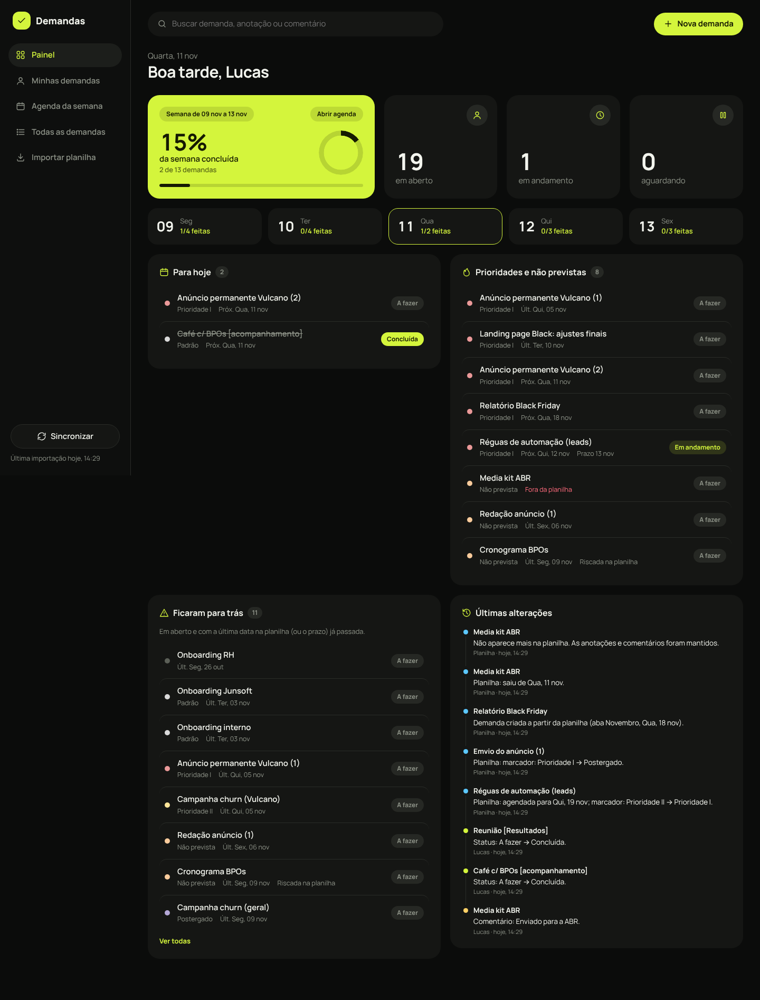
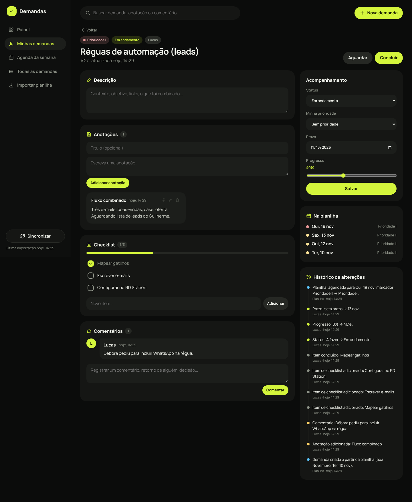

# Demandas

Sistema web para acompanhar as demandas da planilha "Sprint de Marketing", com anotações, comentários, checklist e histórico de alterações em cada demanda.

_As telas usam dados de teste._

## Requisitos

PHP 8.1 ou mais novo com as extensões `pdo_sqlite`, `zip`, `simplexml`, `mbstring` e `curl` (todas costumam vir ativas em hospedagens comuns). Não usa MySQL nem Composer: os dados ficam no arquivo `data/demandas.sqlite`.

## Instalação

1. Copie a pasta `demandas` para o servidor (ou para o seu computador).
2. Defina a senha de login (veja abaixo). Confira `meu_nome` em `config.php`.
3. Garanta que a pasta `data/` tem permissão de escrita.
4. Acesse a pasta pelo navegador.

Para rodar no próprio computador, sem hospedagem:

    cd demandas
    php -S localhost:8080

e abra http://localhost:8080. Use esse modo só localmente: o servidor embutido do PHP não aplica o bloqueio da pasta `data/`. Em Apache o `.htaccess` já bloqueia; em Nginx, negue acesso a `/data` e `/lib`.

## Senha de login

O sistema sempre pede senha, e ela não fica no código nem no Git. Escolha um dos jeitos:

- **Arquivo local**: copie `config.local.exemplo.php` para `config.local.php` e preencha `senha`. Esse arquivo está no `.gitignore`.
- **Variável de ambiente**: defina `DEMANDAS_SENHA` no servidor (útil em hospedagens como Render, Railway ou Docker).

Pode usar a senha em texto ou, melhor, um hash:

    php -r 'echo password_hash("sua-senha", PASSWORD_DEFAULT), PHP_EOL;'

Enquanto nenhuma senha estiver definida, a tela de login avisa e ninguém entra. O token de `sync.php` segue a mesma regra (`sync_token` ou `DEMANDAS_SYNC_TOKEN`).

## Importação da planilha

Há três caminhos, e todos preservam o que foi feito no sistema:

- **Automático**: ao abrir o painel, o sistema busca a planilha pelo link se a última busca tiver mais de `auto_sync_horas` horas. Exige a planilha compartilhada como "qualquer pessoa com o link pode ver".
- **Botão Sincronizar**, no menu lateral.
- **Upload**: em Importar planilha, envie o `.xlsx` baixado em Arquivo > Fazer download > Microsoft Excel. O `.csv` também é aceito, mas não traz as cores dos marcadores.

Para agendar sem depender de abrir o sistema, use o cron:

    0 7-19 * * 1-5 php /caminho/demandas/sync.php

ou chame `sync.php?token=SEU_TOKEN` por um agendador web.

### Como a importação funciona

- Cada demanda é identificada por responsável + texto da célula. A mesma tarefa repetida em vários dias vira uma demanda só, com várias datas.
- A cor de fundo da célula é comparada com a legenda MARCADORES para descobrir o marcador (Padrão, Não prevista, Prioridade I, Prioridade II, Postergado, Outros).
- A cada importação, só as datas e o marcador vindos da planilha são atualizados, e cada mudança entra no histórico da demanda. Status, prazo, progresso, descrição, anotações, comentários e checklist nunca são tocados.
- Se uma tarefa sumir da planilha, a demanda continua no sistema, marcada como "Fora da planilha".
- Se o texto da tarefa for alterado na planilha, ela entra como demanda nova, e a antiga fica como "Fora da planilha" com as anotações.
- "Feriado", "Atestado" e similares (lista em `config.php`) aparecem só como ausência na agenda.

## Backup

Copie o arquivo `data/demandas.sqlite`.
